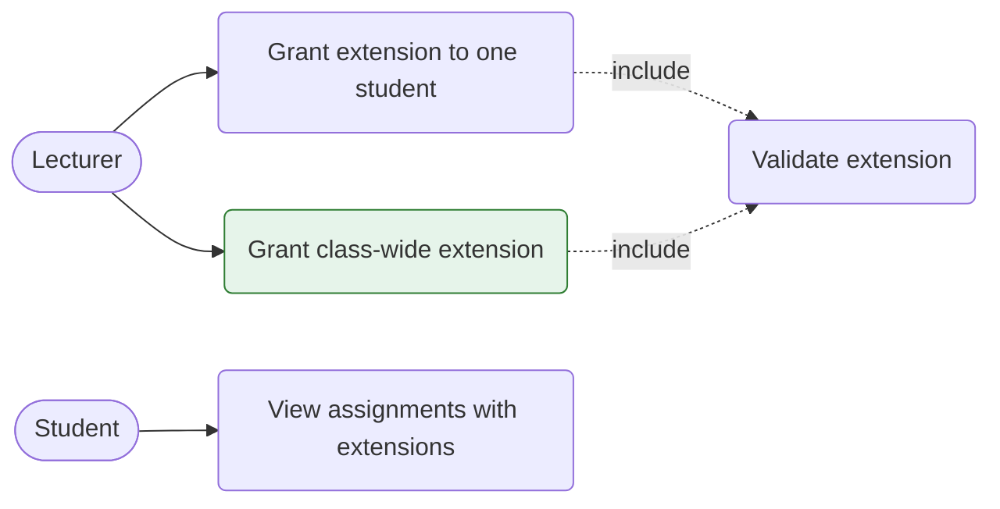
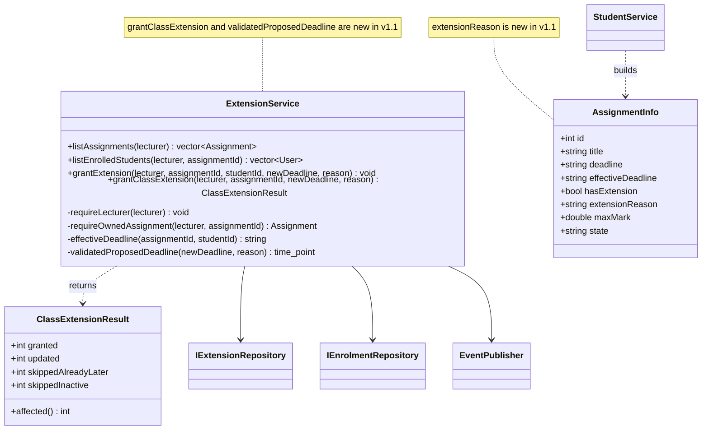
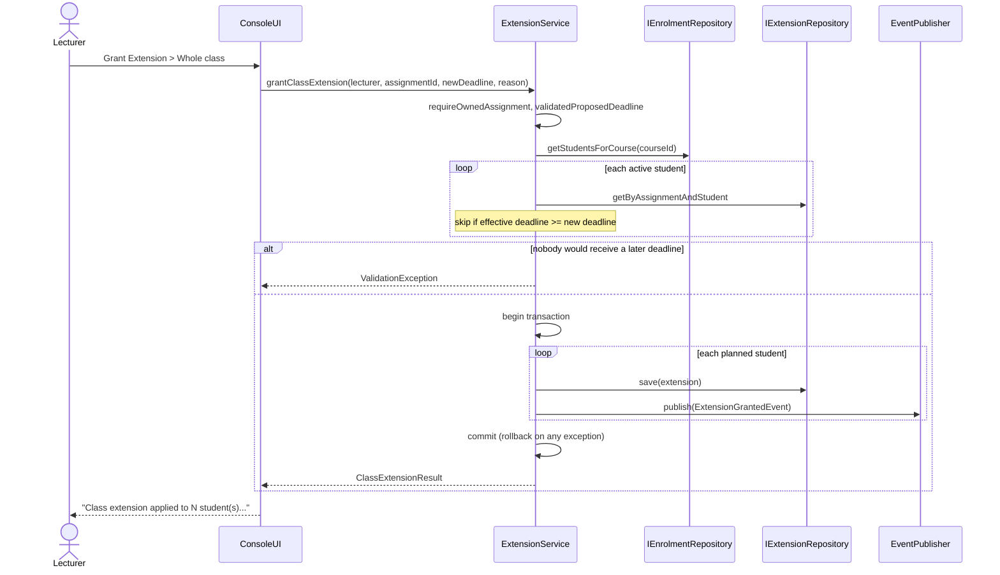
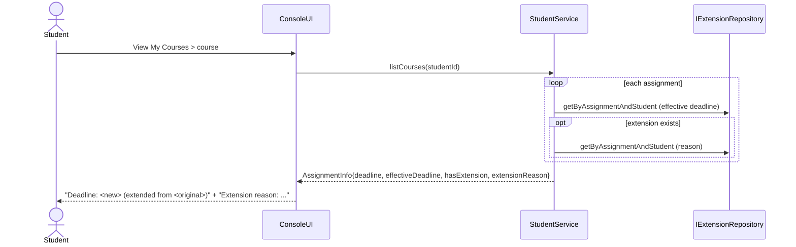
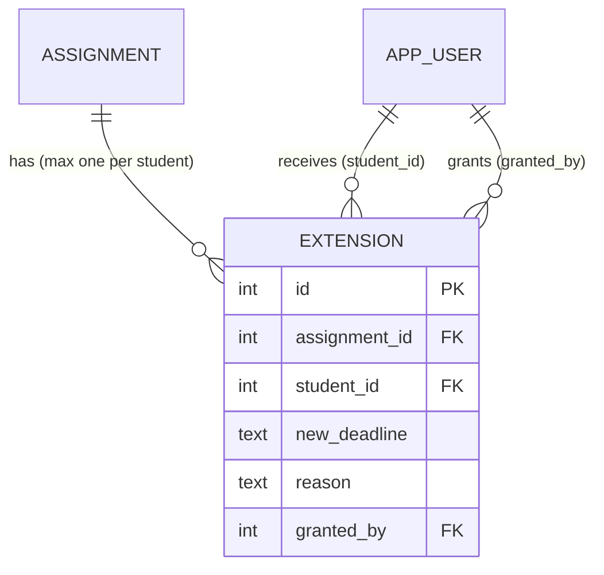

# Change Request CR1 - Class-wide deadline extensions (Release v1.1.0)

| Item | Value |
|---|---|
| Change request | CR1 |
| Raised by | The school (post-release, after v1.0.0) |
| Baseline | v1.0.0 |
| Resulting release | **v1.1.0** (`project(lms VERSION 1.1.0)`) |
| Status | Implemented and regression-tested (see section 7) |

> **CR1:** "A lecturer should be able to extend the deadline for a whole class, not just an individual student, and extensions should be shown on the student's assignment list."

---

## 1. Classification

**Maintenance type: perfective maintenance** (ISO/IEC 14764).

**Justification.** The school asks for new and improved capability in a system that is working as specified:

- v1.0.0 behaves exactly as FR7 is written ("Lecturer grants extensions", per student). Nothing is broken.
- The request adds a user-visible capability (whole-class grant) and improves an existing one (the student list shows only "(extended)"; it will now show the original deadline and the reason).
- Both halves are driven by user needs and workload, so the change is an enhancement to user requirements.

**Why not the other types**

| Type | Why it does not apply |
|---|---|
| Corrective | No defect, failure or deviation from the v1.0 requirements was reported. |
| Adaptive | The operating environment (OS, compiler, SQLite, libraries, regulations) is unchanged. |
| Preventive | The change is not a restructuring done to prevent future faults or to ease maintenance. (A small internal refactor, `validatedProposedDeadline`, is a by-product, not the purpose.) |

---

## 2. Impact analysis

Method: traced every use of `Extension`, `ExtensionService`, `IExtensionRepository`, `getEffectiveDeadline`, `hasExtension` and the `GRANT_EXTENSION` menu action across `src/`, `db/`, `tests/` and `docs/`.

### 2.1 Requirements

| ID | Requirement | Impact | Reason / action |
|---|---|---|---|
| **FR7** | Lecturer grants extensions | **Modified** | Wording extended: "to an individual student **or to a whole class**". |
| **FR7a** (new) | Lecturer grants one deadline extension to every active student enrolled in an assignment's course, in one atomic action; students already holding the same or a later deadline are not shortened | **New** | Implements first half of CR1. |
| **FR7b** (new) | A student's assignment list shows the extended deadline, the original deadline and the extension reason | **New** | Implements second half of CR1. Partly present in v1.0 (`hasExtension` / "(extended)"), so this is an enhancement. |
| DR3 | Extension sets effective deadline | Indirectly affected | Class grant writes the same per-student `extension` rows, so the rule is unchanged. Re-verified by regression. |
| DR2 / FR11 | Late penalty 10% per started day, days 1-3 | Indirectly affected | Penalty is computed from the effective deadline; new boundary test added for class-extended students. |
| DR4 | Resubmission allowed only through the effective deadline | Indirectly affected | Same dependency; covered by existing student tests (re-run). |
| FR10 | Late submissions accepted and flagged | Indirectly affected | Same dependency. |
| FR1 / DR6 | Role-restricted actions; each role scoped to its own data | Affected (must hold) | Class grant must enforce lecturer role, active account, and ownership of the assignment's course. New tests. |
| MUST-PLACEHOLDER-LECTURER | Extension workflow | Affected | Traceability row updated. |
| MUST-PLACEHOLDER-STUDENT | Student course/assignment workflow | Affected | Student list display changed. |
| FR2-FR6, FR8, FR9, FR12, DR1, DR5 | Auth, admin, assignment creation, marking, submission bounds, moderation, release, audit | **Not affected** | No code path shared with the change; confirmed by unchanged test results. |

### 2.2 Design diagrams

The repository holds no diagram source files (the Phase 3 design lives outside the repo). The affected diagrams and their v1.1 replacements (section 4) are:

| Diagram | Affected? | Change |
|---|---|---|
| Use-case diagram (Lecturer) | **Yes** | Add use case "Grant class-wide extension" as a sibling of "Grant extension" (both include "Validate extension"). |
| Class diagram - application layer | **Yes** | `ExtensionService` gains `grantClassExtension`; new value type `ClassExtensionResult`. |
| Class diagram - DTOs | **Yes** | `AssignmentInfo` gains `extensionReason`. |
| Sequence diagram "Grant extension" | **Yes** | New sibling sequence "Grant class extension" (fan-out in one transaction). |
| Sequence diagram "View assignments" (student) | **Yes** | One extra `getByAssignmentAndStudent` call when an extension exists. |
| ER diagram / data dictionary | **No change** | `extension` table is unchanged (decision D1). Constraint `one_extension_per_assignment_student` is now relied on by bulk grants and is annotated. |
| Submission state-machine diagram | No | States and transitions unchanged. |
| Observer/event diagram | No | `ExtensionGrantedEvent` is reused; it is now published once per affected student. |
| Deployment / component diagram | No | No new components or dependencies. |

### 2.3 Classes

| Class / file | Impact | Change |
|---|---|---|
| `ExtensionService` (`.h/.cpp`) | **Changed** | + `grantClassExtension()`, + `ClassExtensionResult`, + private `validatedProposedDeadline()` (shared with `grantExtension`, same check order as v1.0). |
| `StudentService` (`.h/.cpp`) | **Changed** | `AssignmentInfo.extensionReason`; filled when an extension exists. |
| `ConsoleUI` (`.cpp`) | **Changed** | Grant-extension handler asks "one student / whole class"; student assignment list prints "(extended from <original>)" and the reason. |
| `CMakeLists.txt` | Changed | Version 1.0.0 -> 1.1.0. |
| `IExtensionRepository` / `SqliteExtensionRepository` | Not changed | Existing `getByAssignmentAndStudent` and `save` (upsert by id) are sufficient. |
| `Extension` entity, `ExtensionGrantedEvent`, `NotificationService` | Not changed | Reused as is. One notification per affected student ("Extension granted/updated; new deadline...; reason...") is the intended behaviour. |
| `MarkingService`, `LatePenaltyStrategy`, `SubmissionStateMachine` | Not changed | They use the effective deadline only; verified by regression tests. |
| `MenuService` + `tests/golden/menu_actions.txt` | Not changed | Menu key `GRANT_EXTENSION` and label are unchanged; the scope choice is a sub-prompt. |
| `FakeExtensionRepository` (tests) | Not changed | Not needed by the new tests (class path is tested against real SQLite). |

### 2.4 Tables and constraints

| Object | Impact |
|---|---|
| `extension` | **No schema change.** A class grant inserts or updates one row per student. Unique index `one_extension_per_assignment_student(assignment_id, student_id)` guarantees a re-grant updates rather than duplicates. FKs and `ON DELETE CASCADE` unchanged. |
| `notification` | More rows per action (one per affected student); no schema change. |
| `assignment`, `submission`, `app_user`, `course`, `enrolment`, `mark_audit` | Read-only use or untouched. |
| **Data migration** | **None.** v1.0 databases open unchanged under v1.1 (upgrade = replace the executable). |

### 2.5 Test cases

| Existing test | Impact |
|---|---|
| `StudentServiceIntegrationTest.EffectiveDeadlineWithExtension` | Re-run unchanged (asserts `hasExtension`, `effectiveDeadline`). |
| `StudentServiceIntegrationTest.DeadlineAndExtensionBoundariesUseStartedDays` | Re-run unchanged (TEST_PLAN DL09-DL11). |
| `ModerationWorkflowIntegrationTest.EndToEndWorkflow` | Re-run unchanged; exercises single-student `grantExtension` after the shared-validation refactor. |
| `MenuGolden*` (golden menu) | Re-run unchanged; must stay identical. |
| All other unit/integration tests (135 in total) | Re-run unchanged as the regression suite. |
| TEST_PLAN cases DL09, DL10, DL11, ST02-ST04 | Re-verified by the suite above. |
| **New:** 27 tests | `tests/unit/test_extension_service.cpp` (11), `tests/integration/test_class_extension.cpp` (16). Listed in section 7 and TEST_PLAN section 8. |

### 2.6 Documentation affected

`RELEASE_NOTES.md`, `TRACEABILITY.md`, `TEST_PLAN.md`, `USER_MANUAL_LECTURER.md`, `USER_MANUAL_STUDENT.md`, `MANUAL_TEST.md`, `CONFIGURATION_MANAGEMENT.md`, `INSTALLATION_GUIDE.md`, `README.md`. Not affected: Admin and HoD manuals, CODING_STANDARD, BUILDING, STATIC_ANALYSIS.

### 2.7 Risks and ripple effects

| Risk | Mitigation |
|---|---|
| Partial class grant (some students updated, others not) if a failure occurs midway | All writes and notifications run inside one `TransactionGuard`; test `ClassGrantIsAtomicWhenAnObserverFailsMidway`. |
| A class grant silently shortens an existing, later, individual extension | Students whose effective deadline is already >= new deadline are skipped and reported; test `ClassGrantNeverShortensAnExistingLaterExtension`. |
| Refactoring the validation changes single-student behaviour | Helper called at the same point as the old inline checks; 4 dedicated regression tests incl. error-ordering. |
| Wrong students affected (other course, inactive) | Roster comes from course enrolment; inactive accounts are skipped and counted; tests for both. |
| Penalty/lateness drift | Boundary tests: on time at class deadline, late (10%) one second after. |
| UI flow change for lecturers | One extra prompt ("1. One student / 2. Whole class"); documented in the lecturer manual and release notes. |

---

## 3. Design decision

**D1 - Fan-out to per-student rows (chosen).** `grantClassExtension` computes the active enrolled students, skips those already at or beyond the new deadline, and saves one `extension` row per remaining student in a single transaction, publishing one `ExtensionGrantedEvent` each.

| Alternative | Verdict |
|---|---|
| **D2 - new `class_extension` table** (one row per assignment, consulted when no individual row exists) | Rejected: schema migration, a second source of truth for the effective deadline in `StudentService`, `MarkingService` and `ExtensionService`, and precedence rules between class and individual rows. Higher regression risk across DR2-DR4. |
| **D3 - loop calling `grantExtension` from the UI** | Rejected: not atomic, duplicated validation in the presentation layer, inconsistent partial results. |

D1 keeps DR3 intact (effective deadline = the student's extension row), needs no migration, and preserves the notification and audit path.

---

## 4. Updated design (v1.1)

### 4.1 Use cases

### 4.2 Class diagram (changed parts)

### 4.3 Sequence - grant class extension

### 4.4 Sequence - student assignment list

### 4.5 Data model (unchanged)

`UNIQUE (assignment_id, student_id)` - a class grant is a bulk insert/update of these rows.

---

## 5. Implementation summary (v1.1.0)

| File | Change |
|---|---|
| `CMakeLists.txt` | version 1.1.0 |
| `src/application/ExtensionService.h/.cpp` | `ClassExtensionResult`, `grantClassExtension`, `validatedProposedDeadline` (shared) |
| `src/application/StudentService.h/.cpp` | `AssignmentInfo::extensionReason` |
| `src/presentation/ConsoleUI.cpp` | scope prompt (one student / whole class) and result summary; student list shows original deadline and reason |
| `tests/unit/test_extension_service.cpp` | new, 11 tests |
| `tests/integration/test_class_extension.cpp` | new, 16 tests |
| `docs/*` | this document, release notes, traceability, test plan, manuals, manual test, config management, installation guide, README |

Business rules of `grantClassExtension`: lecturer must be an active Lecturer who owns the assignment's course; reason required (not blank); new deadline required and valid ISO 8601 UTC; only **active enrolled students** are considered; a student whose current effective deadline is already the same or later is skipped (never shortened); if nobody would change, the request is rejected; all-or-nothing in one transaction; one notification per affected student.

## 6. Known limitations (v1.1.0)

- The whole class means every active student enrolled in the assignment's course; choosing a subset still uses the single-student option.
- One reason applies to all students in a class grant.
- Extensions still cannot be revoked or shortened (unchanged from v1.0).
- There is no confirmation prompt before a class grant (the result summary reports what changed).
- The console UI has no automated tests; the UI change was verified by a scripted smoke run (section 7.3) and the manual test in `MANUAL_TEST.md`.

## 7. Regression testing

### 7.1 Results

| Suite | v1.0.0 baseline | v1.1.0 | New in v1.1.0 | Failed |
|---|---:|---:|---:|---:|
| Unit | 102 / 102 | 113 / 113 | 11 | 0 |
| Integration | 33 / 33 | 49 / 49 | 16 | 0 |
| **Total** | **135 / 135** | **162 / 162** | **27** | **0** |

All 135 pre-existing tests were re-run **unchanged** and still pass. Evidence: `docs/regression/baseline_v1.0.txt` and `docs/regression/results_v1.1.txt`.

**How the results were produced.** The development sandbox had no CMake and no network, so the unmodified test sources were built with `g++` against a minimal GoogleTest-compatible shim and the system SQLite library (real `db/schema.sql`, real bcrypt sources). Before tagging, repeat the official run: `cmake -S . -B build -G "MinGW Makefiles"`, `cmake --build build`, `ctest --test-dir build --output-on-failure`, and replace the evidence files with that output.

### 7.2 New tests

Unit (`ExtensionServiceUnitTest`, fakes): class grant rejects non-lecturer, lecturer of another course, inactive lecturer, unknown assignment, empty/blank reason, empty deadline, and a course with no students; single-student grant regression tests (saves one row and publishes once; rejects deadline not later than current; rejects empty reason / not enrolled; student checks still precede input validation).

Integration (`ClassExtensionIntegrationTest`, real SQLite): one extension per enrolled student; other courses/assignments untouched; inactive students skipped; existing later extension never shortened; earlier extensions updated in place (still one row per student); rejected when nobody would get a later deadline; bad input and wrong lecturer save nothing; one notification per affected student; **atomic rollback when a notification observer fails**; student list shows original + extended deadline + reason; list unchanged for unextended assignments; extension visible only to affected students; submission between original and class deadline is on time; one second after class deadline is Late with 10% penalty; student outside the class keeps the original deadline; single-student grant still affects only that student.

**Mutation check.** Removing the "never shorten" guard and the transaction made 3 of the new tests fail (`ClassGrantNeverShortensAnExistingLaterExtension`, `ClassGrantRejectedWhenNobodyWouldGetALaterDeadline`, `ClassGrantIsAtomicWhenAnObserverFailsMidway`), confirming the tests detect real regressions.

### 7.3 Scripted smoke run (console app)

With a fresh `--seed-demo` database: `lecturer1` created an assignment on CS101, chose **Grant Extension -> Whole class**, and the app reported "Class extension applied to 2 student(s) (2 new, 0 updated)." `student1` then saw, under CS101 assignments, "Deadline: 2035-06-05T12:00:00Z (extended from 2035-06-01T14:00:00Z)" and "Extension reason: Campus network outage". The integration test `StudentListShowsExtensionOnlyToAffectedStudents` covers students outside the class.
